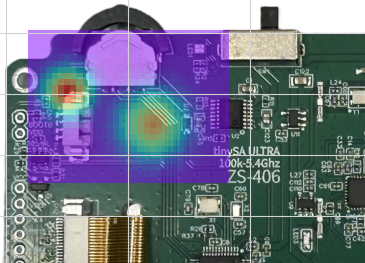

# Near Field Scanner

Near field scanner is a tool to determine from where and how much a circuit board is radiating in the RF spectrum. The tool uses a spectrum analyzer + a CNC XY-table to measures and gives a visual image of the RF-emissions from the circuitboard.



## 🌟 Key Features

- **Hardware Abstraction Layer**: Connects via PyVISA (GPIB/USB/Ethernet) for spectrum analyzers and PySerial (GRBL/G-code) for CNC motion tables.

- **Background Image Calibration**: Import PCB board photos, align optical pixel coordinates to physical CNC coordinates, and rotate overlay graphics.

- **Configurable Scan Execution**:

- Customizable scan boundaries, step sizes, probe clearance, and sweep parameters.

- Real-time measurement preview, ETA calculator, and live sweep progress tracking.

- **Interactive Result Viewer**:

- Spatial radiation heatmap overlays synced directly on top of PCB background photos.

- Interactive frequency zoom sliders, marker measurements, delta frequency calculations, and image export.

- **Modular Codebase**: Clean, decoupled architecture supporting standalone module testing and easy addition of custom spectrum analyzer drivers.

## 🛠️ System Architecture & Hardware Requirements

### Hardware Dependencies

1. **Spectrum Analyzer**: Drivers are included for the HP 8591 (GPIB, via PyVISA) and the TinySA (USB serial). Other instruments can be added by writing a driver module in `hardware/spectrum_analyzers/`. Each driver also declares the frequency range and number of points that the instrument supports, and the application limits the scan settings accordingly. See the existing drivers for the functions a driver needs.

2. **XYZ Motion Table**: CNC router table (e.g., CNC 3018 running GRBL) or custom linear stages accepting serial G-code commands.

3. **RF Near-Field Probe**: Passive or active H-field / E-field probe attached to the CNC spindle head.

4. **Low noise amplifier**: Recommended to lower the noise floor for more accurate measurements.

## 📁 Repository Structure

```
Near-field-scanner/        
│        
├── near_field_scanner.py      # Main application launcher        
├── scan_config.py             # Global runtime settings & configuration        
│        
├── modules/                   # GUI pages and application workflows        
│   ├── scan_setup.py          # Tab 0: Hardware configuration & project management        
│   ├── scan_calibrate.py      # Tab 1: Image alignment & spatial coordinate calibration        
│   ├── scan_execute.py        # Tab 2: Scan boundaries, frequency span & execution        
│   ├── scan_result.py         # Tab 3: Heatmap visualization, markers & analysis        
│   └── scan_help.py           # F1 Context help manager        
│        
├── hardware/                  # Instrument drivers        
│   ├── scanners/              # CNC motion table drivers        
│   ├── mechanics/             # STEP and STL-files for probe holders        
│   └── spectrum_analyzers/    # HP 8591, tinySA and other spectrum analyzer drivers        
│        
├── assets/                    # Application icons and help graphics        
├── background_images/         # User PCB photos and reference board images        
└── results/                   # Saved scan datasets (.nfs) and exported screenshots
```

## 🚀 Getting Started

### Prerequisites

- **Python 3.7+** (Python 3.7 is recommended on Windows for PyVISA GPIB driver stability. The application has also been tried with Python 3.14).

- Operating System: Windows, Linux (untested), or macOS (untested).

### Installation

1. **Clone the repository**:

```
git clone https://github.com/JacobRengman/Near-field-scanner.git    
cd Near-field-scanner
```

1. **Install required dependencies**:

```
pip install matplotlib numpy pillow pyvisa pyserial
```

1. **Verify VISA Backend**: Ensure [NI-VISA](https://www.ni.com/en/support/downloads/drivers/download.ni-visa.html) or [PyVISA-py](https://pyvisa-py.readthedocs.io/) is installed on your operating system so PyVISA can discover connected VISA instruments. Using Keysight Connection Expert is also recommended to get VISA instruments to work.

## 💻 Usage

### Running the Application

Launch the complete suite from the root directory of the repository (the application uses relative paths to `assets/`, `background_images/` and `results/`):

```
python near_field_scanner.py
```

### Running Individual Modules in Standalone Mode

Each feature module in `modules/` can be executed independently for isolated testing or debugging:

```
python modules/scan_setup.py        
python modules/scan_execute.py
```

## 📖 Recommended Workflow

1. **Scan Setup (Tab 1)**: Select your Spectrum Analyzer VISA address and CNC COM port. Click **Test** to verify communication. Create a new project name or copy settings from an existing `.nfs` project file.

2. **Background Calibration (Tab 2)**: Load a PCB image from `background_images/`. It works best with a screenshot of a component placement drawing but a photo also works. Define optical calibration points on the image and pair them with physical CNC probe locations.

3. **Execute Scan (Tab 3)**: Define the x,y scan bounds, step size, frequency span (start/stop), and averaging sweeps. Run the automated scan.

4. **Show Results (Tab 4)**: Inspect localized EMI hot spots over the board photo, analyze peak spectrum frequencies using markers, and export screenshots to `results/`.

## 🖼️ Example Images, Trademarks & Disclaimer

The example board photograph in `background_images/` (`TinySA_PCB_bot.png`) was taken by the author of a commercially available tinySA spectrum analyzer that the author purchased. It is included only to demonstrate how the software works with a real circuit board and any included heatmap is not a measurement of the TinySA PCB itself.

- This project is an independent, non-commercial open source project. It is **not affiliated with, authorized by, sponsored by, or endorsed by** the manufacturer or designer of the board shown, or by the owners of any other product or company named in this repository.

- Product names, brand names and logos that appear in the images or in the text (including TinySA, HP/Hewlett-Packard, Keysight and NI-VISA) are the property of their respective owners and are used for identification purposes only.

- The photograph is provided for demonstration only. The software license below applies to the source code. It does not grant any rights to the design, firmware, trademarks or other intellectual property of the photographed product.

- Any measurement results shown are mathematically generated examples only and are not a statement about the quality, EMC performance or compliance of the photographed product.

- If you are a rights holder and would like the image changed or removed, please open an issue in this repository and it will be handled promptly.

This software is provided "as is", without warranty of any kind. Use it at your own risk. This includes risk to your equipment: the author takes no responsibility for damage to instruments, probes, scanners or devices under test.

## 📄 License

This project is licensed under the GNU General Public License v2.0 or later - see the [LICENSE](file:///C:/Python/GitHub/Near-field-scanner/LICENSE) file for details.

```
Copyright (C) 2024-2026 Jacob Rengman        
        
This program is free software: you can redistribute it and/or modify        
it under the terms of the GNU General Public License as published by        
the Free Software Foundation, either version 2 of the License, or        
(at your option) any later version.
```

## 🤝 Contributing & Credits

- **Initial Author & EMC Lead**: Jacob Rengman ([www.irr.se](https://www.irr.se/))

- **Background Research**: Göran Nordahl ([www.lohmega.com](https://www.lohmega.com/))

- **Embedded Software**: Stefan Petersen ([www.spe.ciellt.se](https://www.spe.ciellt.se/))

Pull requests are welcome! If you write a driver module for an additional spectrum analyzer model, please place it in the `hardware/` folder and submit a PR.

